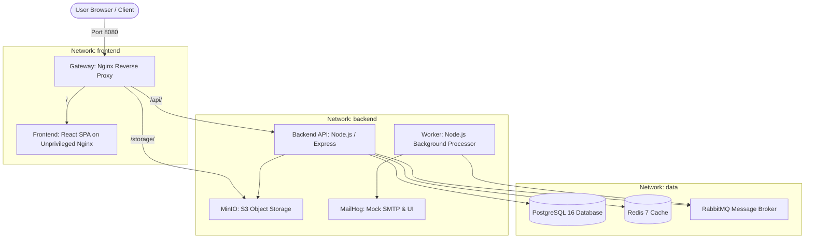

# CampusHub - Containerized Event Management Platform

CampusHub is a full-stack event registration and management platform designed with a microservices architecture. It demonstrates production-grade containerization with Docker and Docker Compose, multi-stage builds, non-root security enforcement, least-privilege network isolation, health-aware service orchestration, and persistent storage.

---

## 1. Architecture Overview

CampusHub is composed of 9 specialized services running across three isolated Docker bridge networks:



### Services Contract

| Service | Base Image | Internal Port | Published Port | Purpose |
|---|---|---|---|---|
| **gateway** | `nginxinc/nginx-unprivileged:1.27-alpine` | `8080` | `8080` (public 0.0.0.0) | Single entry point, reverse proxy, upload limits, non-root |
| **frontend** | Multi-stage build on `nginxinc/nginx-unprivileged:1.27-alpine` | `8080` | None | Serves compiled React production bundle |
| **api** | Multi-stage build on `node:20.18-alpine3.20` | `3000` | None | Runs migrations, seeds database, handles REST endpoints |
| **worker** | Reuses API image (`campushub-api`) | None | None | Consumes event registration queue and delivers SMTP emails |
| **db** | `postgres:16-alpine` | `5432` | None | Relational database with persistent volume |
| **redis** | `redis:7-alpine` | `6379` | None | In-memory cache for event listings with TTL and invalidation |
| **rabbitmq** | `rabbitmq:3.13-management-alpine` | `5672`, `15672` | `127.0.0.1:15672` | AMQP message broker with management UI on localhost |
| **minio** | `cgr.dev/chainguard/minio:latest` | `9000`, `9001` | None | S3-compatible media object storage with persistent volume |
| **mailhog** | `mailhog/mailhog:v1.0.1` | `1025`, `8025` | `127.0.0.1:8025` | Mock SMTP server and webmail inspector on localhost |

---

## 2. Prerequisites

- [Docker Engine](https://docs.docker.com/engine/) (v24.0+)
- [Docker Compose](https://docs.docker.com/compose/) (v2.20+)
- [Git](https://git-scm.com/)
- [cURL](https://curl.se/) and [Bash](https://www.gnu.org/software/bash/) (for running tests/grading)

---

## 3. Environment Configuration

All environment variables are managed via `.env`. A template is provided in `.env.example`.

1. Copy `.env.example` to `.env`:
   ```bash
   cp .env.example .env
   ```
2. Verify or update variables in `.env`:
   ```env
   GATEWAY_PORT=8080
   PORT=3000
   PGHOST=db
   PGUSER=campus
   PGPASSWORD=change-me
   PGDATABASE=campushub
   REDIS_HOST=redis
   REDIS_PORT=6379
   REDIS_PASSWORD=change-me-redis
   RABBITMQ_HOST=rabbitmq
   RABBITMQ_USER=campus
   RABBITMQ_PASS=change-me-mq
   MINIO_ENDPOINT=minio
   MINIO_PORT=9000
   MINIO_ACCESS_KEY=minioadmin
   MINIO_SECRET_KEY=change-me-too
   MINIO_BUCKET=campushub
   SMTP_HOST=mailhog
   SMTP_PORT=1025
   ```
   > **Note:** `.env` is excluded from git tracking (`.gitignore`) and Docker build contexts (`.dockerignore`).

---

## 4. Docker Compose Commands

### Start the Application
Build all images and wait for all containers to report healthy:
```bash
docker compose up -d --build --wait
```

### Check Container Status
Verify all 9 containers are running and healthy:
```bash
docker compose ps
```

### View Application Logs
Tail logs from all services or a specific service:
```bash
docker compose logs -f
docker compose logs -f api worker
```

### Stop the Application (Preserving Data)
Stops and removes containers and networks, keeping persistent volumes intact:
```bash
docker compose down
```

### Restart the Application
Restart existing containers:
```bash
docker compose restart
```

### Tear Down and Purge Volumes (Full Reset)
> **Warning:** This removes all PostgreSQL database records and MinIO uploaded files:
```bash
docker compose down -v
```

---

## 5. Application Access URLs

| Interface | URL | Access Level | Description |
|---|---|---|---|
| **CampusHub Web App** | [http://localhost:8080/](http://localhost:8080/) | Public (0.0.0.0) | Main frontend React application |
| **API Healthcheck** | [http://localhost:8080/api/health](http://localhost:8080/api/health) | Public (0.0.0.0) | Verifies DB and Redis connectivity |
| **API Events API** | [http://localhost:8080/api/events](http://localhost:8080/api/events) | Public (0.0.0.0) | List events (cached in Redis) |
| **Media Storage** | [http://localhost:8080/storage/](http://localhost:8080/storage/) | Public (0.0.0.0) | Proxied MinIO bucket for event images |
| **MailHog Webmail** | [http://127.0.0.1:8025/](http://127.0.0.1:8025/) | Localhost Only | View registration emails delivered by worker |
| **RabbitMQ Management** | [http://127.0.0.1:15672/](http://127.0.0.1:15672/) | Localhost Only | Monitor queues and message rates (User: `campus`) |

---

## 6. Key Architectural Decisions

### Decision 1: Multi-Stage Frontend Build with Unprivileged Nginx
- **Reasoning:** In production, running a Node.js development server or keeping npm build dependencies in the runtime container creates unnecessary bloat and increases the attack surface. By utilizing a multi-stage build, Node.js and the source code are discarded after generating the `dist/` bundle. The static assets are served using `nginxinc/nginx-unprivileged:1.27-alpine`, ensuring non-root execution (UID 101) with a minimal footprint (<30 MB).

### Decision 2: Single Image Reuse for API and Worker with Customized Healthchecks
- **Reasoning:** The API server and background worker share the same Node.js runtime, dependencies, and queue definitions. Rather than maintaining duplicate Dockerfiles and duplicating build layers, the worker service reuses the `campushub-api` image by overriding the entrypoint command (`node src/worker.js`). Because the worker does not expose an HTTP port, the API's HTTP healthcheck is overridden with a process-level healthcheck (`pgrep -f 'node src/worker.js'`), allowing Compose `--wait` to verify that both services are healthy.

### Decision 3: Network Segmentation and Least-Privilege Port Exposure
- **Reasoning:** To prevent lateral movement and unintended exposure, three separate bridge networks (`frontend`, `backend`, `data`) partition the services. Only the Gateway reverse proxy binds to public host interfaces (`0.0.0.0:8080`). All backend services communicate exclusively over internal Docker DNS names. Administrative interfaces for MailHog and RabbitMQ are strictly bound to loopback (`127.0.0.1`), ensuring zero external exposure of management tooling.

---

## 7. Persistent Storage

Two named volumes ensure business data persists across container lifecycles:
- `pgdata`: Mounted to `/var/lib/postgresql/data` in the `db` service. Stores PostgreSQL database tables, event entries, and registration records.
- `miniodata`: Mounted to `/data` in the `minio` service. Stores event images and S3 bucket metadata.

Executing `docker compose down` retains these volumes. Only explicitly appending `-v` (`docker compose down -v`) will delete persistent state.

---

## 8. Automated Grading Verification

The repository includes `grade.sh` to validate all infrastructure and functional requirements:
```bash
DC="docker compose" ENV_FILE=.env ./grade.sh
```
The script validates:
- Zero container startup errors under `docker compose up -d --build --wait`.
- Exactly 9 healthy containers running.
- Gateway routing for frontend, API, and storage.
- Database migrations and initial seed execution.
- Redis cache hits on subsequent queries.
- Asynchronous email worker delivery to MailHog via RabbitMQ.
- Multipart image upload and public retrieval through MinIO.
- Named volume persistence across down/up cycles.
- Non-root user compliance across all exposed application containers.
- Single public port exposure on `0.0.0.0`.
- API image size under 250 MB.
- Absence of un-interpolated plaintext credentials in compose definitions.

---

## 9. Troubleshooting

- **Port 8080 already in use:**
  If a local service (such as Oracle XDB or Apache) is listening on port 8080 on the host, either disable that service or set `GATEWAY_PORT=8088` in `.env`.
- **Worker not sending emails:**
  Inspect worker logs via `docker compose logs worker`. Ensure RabbitMQ and MailHog are healthy and ready to accept connections.
- **MinIO Access Denied:**
  Verify that `MINIO_ACCESS_KEY` and `MINIO_SECRET_KEY` in `.env` match the credentials supplied in `docker-compose.yml`.
